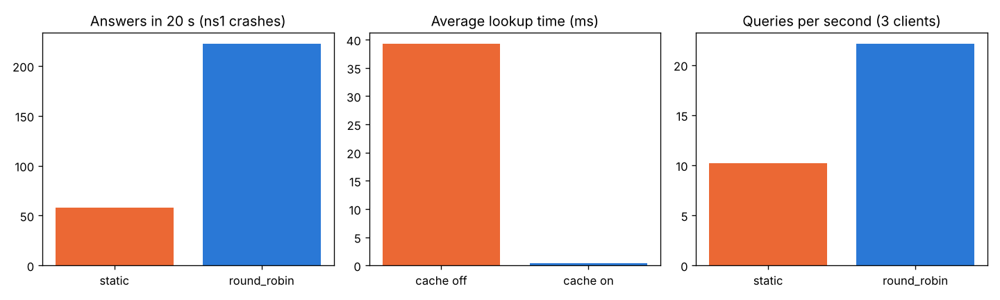

# Distributed DNS-Like Name Resolution System with SDN

Computer Networks mini project. **Protocol: UDP.** Environment: Mininet + Open vSwitch + POX controller.

**Team:** _add your names and SRNs here_

A small DNS-like service: clients ask "what is the IP address of `www.cn.lab`?" over **UDP**,
and name servers answer. An **SDN controller** decides which server answers each query,
notices when a server fails, and sends the queries to the servers that are still alive.

## What it does (problem statement checklist)

| Requirement | How we did it | File |
|---|---|---|
| UDP name-resolution queries | client and server talk with JSON messages inside UDP packets (port 53) | `dns_client.py`, `dns_server.py` |
| Maintain name-to-IP mappings | mappings are stored in JSON files; new ones can be added at runtime and are copied to the other servers | `records.json`, `dns_server.py` |
| Multiple resolution servers | ns1, ns2, ns3 have the same data; ns4 has the `research.cn.lab` names | `topology.py` |
| Caching | the client remembers answers until their TTL runs out | `dns_client.py` |
| Handle timeouts | if no reply comes, the client tries again and waits twice as long (1 s → 2 s → 4 s) | `dns_client.py` |
| Detect server failures | servers send a heartbeat every 0.5 s; no heartbeat for 1.5 s = dead. A cut cable is detected at once | `dns_controller.py` |
| Redirect requests | the controller sends queries away from dead servers; a server can also say "ask 10.0.0.14" (REFER) | `dns_controller.py`, `dns_server.py` |
| Measure lookup latency | every lookup is timed in milliseconds; `--bench` gives average / p95 / max | `dns_client.py` |

## The network

```
                      POX controller (dns_controller.py)
                                  |  OpenFlow
                              s1 (core)
                             /         \
                  s2 (clients)          s3 (servers)
                  /    |    \          /    |    |    \
                c1    c2    c3       ns1  ns2  ns3   ns4
             10.0.0.1  .2   .3       .11  .12  .13   .14
                                    (cn.lab names,   (research.cn.lab)
                                     behind 10.0.0.53)
```

## How it works (in 5 steps)

1. Clients send every query to **one virtual IP, 10.0.0.53**. No host has this address; the controller answers ARP for it.
2. The first packet of a query reaches switch s2, which has no rule for it, so it sends the packet to the controller (**packet-in**).
3. The controller picks a live server (**round robin**) and installs **two rules** in the switch:
   - forward: `client → 10.0.0.53` is rewritten to `client → chosen server`
   - reverse: the server's reply is rewritten so it looks like it came from `10.0.0.53`
4. The server looks up the name and replies. The client checks the reply (right server, right id), saves it in the cache and prints the time it took.
5. Every server sends a **heartbeat** every 0.5 s. If a server stops (or its cable is cut), the controller marks it **DOWN** and deletes the rules, so the next queries go to the other servers.

The `static` policy is our **baseline**: it always uses ns1 and ignores failures, like a normal fixed DNS server.

## The files

| File | Lines | What it is |
|---|---|---|
| `dns_server.py` | ~150 | the name server: UDP socket, look up names, aliases, REFER, add + copy to peers, heartbeats |
| `dns_client.py` | ~180 | the client: send query, timeout + retry, cache, follow REFER, latency, `--bench` load test |
| `dns_controller.py` | ~230 | the SDN controller (runs inside POX): proxy ARP, choose server, install rules, heartbeats, failure handling |
| `topology.py` | ~120 | builds the Mininet network, starts the controller and the servers, opens the Mininet CLI |
| `experiment.py` | ~140 | runs the 3 experiments (static vs dynamic) and writes `results.txt` and `results.png` |
| `test_local.py` | ~110 | 9 automatic tests that run on any laptop (no Mininet needed) |
| `records.json`, `research_records.json` | | the name → IP mappings |

## How to run

**Install once** (Ubuntu):
```bash
sudo apt install -y mininet openvswitch-switch python3-matplotlib
git clone https://github.com/noxrepo/pox ~/pox
```

**Tests** (no sudo):
```bash
python3 test_local.py          # 9 tests -> OK
```

**Start the network:**
```bash
sudo python3 topology.py                   # dynamic SDN (round robin)
sudo python3 topology.py --policy static   # baseline
```

**Try at the `mininet>` prompt:**
```
c1 python3 dns_client.py www.cn.lab mail.cn.lab portal.cn.lab nope.cn.lab
c1 python3 dns_client.py db.cn.lab --repeat 3          # caching: 2nd and 3rd answer "from cache"
c2 python3 dns_client.py lab1.research.cn.lab          # redirect: "ns3 says: ask 10.0.0.14"
c3 python3 dns_client.py --bench 5 --no-cache          # answered by ns1, ns2, ns3 equally
c1 python3 dns_client.py --add new.cn.lab 192.168.50.5 --server 10.0.0.11
sh ovs-ofctl dump-flows s2                             # the rules the controller installed
ns1 pkill -f "dns_server.py ns1"                       # crash ns1
c1 python3 dns_client.py --bench 5 --no-cache          # still 100 % success (ns2, ns3)
link s3 ns2 down                                       # cut ns2's cable
sh tail controller.log                                 # "server 10.0.0.12 is DOWN (link down)"
exit
```

**Experiments** (about 3 minutes):
```bash
sudo python3 experiment.py
```

If every query times out (machines without the Open vSwitch kernel module, e.g. WSL), add `--userspace`
to `topology.py` / `experiment.py`. If something is stuck: `sudo mn -c; sudo pkill -f pox.py`.

## Results

From `experiment.py` (your numbers will be a little different):

| Experiment | Baseline (static) | Dynamic SDN (round robin) |
|---|---|---|
| ns1 crashes after 5 s (20 s run) | 58 answers, 3 failed queries | **222 answers, 0 failed** (one query waited ~1 s) |
| Load: slow servers, 3 clients | 10.2 queries/s, avg 299 ms | **22.1 queries/s, avg 137 ms** |

| Caching | cache off | cache on |
|---|---|---|
| average lookup time | 39 ms | **0.4 ms** |



## Message format (JSON over UDP)

```
query  : {"type": "query", "id": 1234, "name": "www.cn.lab"}
answer : {"id": 1234, "status": "OK", "name": "www.cn.lab", "ip": "192.168.10.10", "ttl": 60, "server": "ns1"}
others : status "NOT_FOUND", or "REFER" with "ask": "10.0.0.14"
add    : {"type": "add", "id": 99, "name": "new.cn.lab", "ip": "192.168.50.5"}
heartbeat (server -> 10.0.0.254:9999): {"type": "heartbeat", "server": "ns1"}
```
